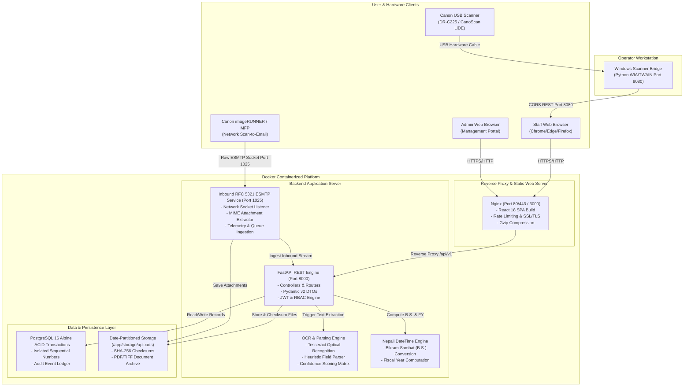
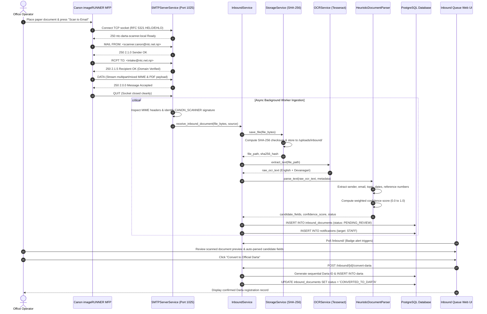
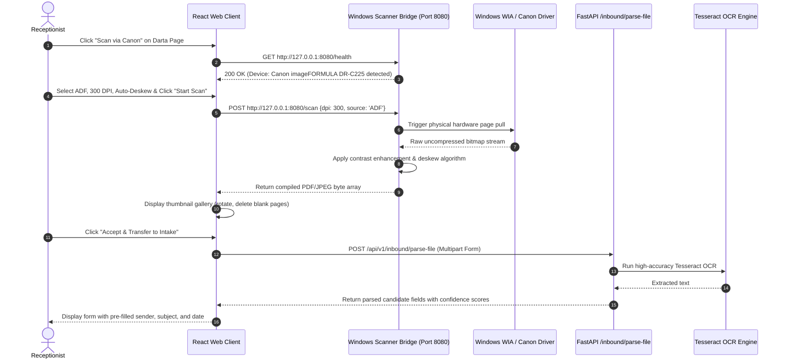
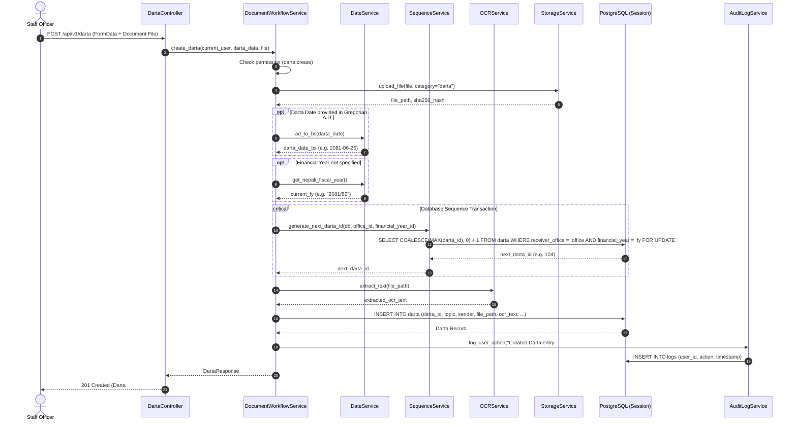
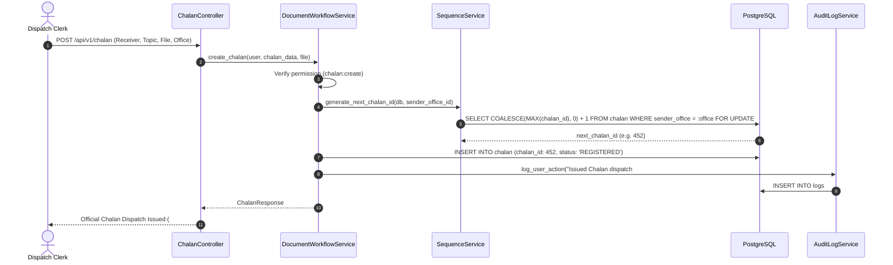
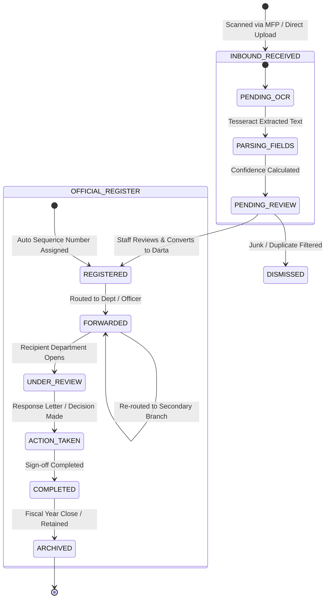
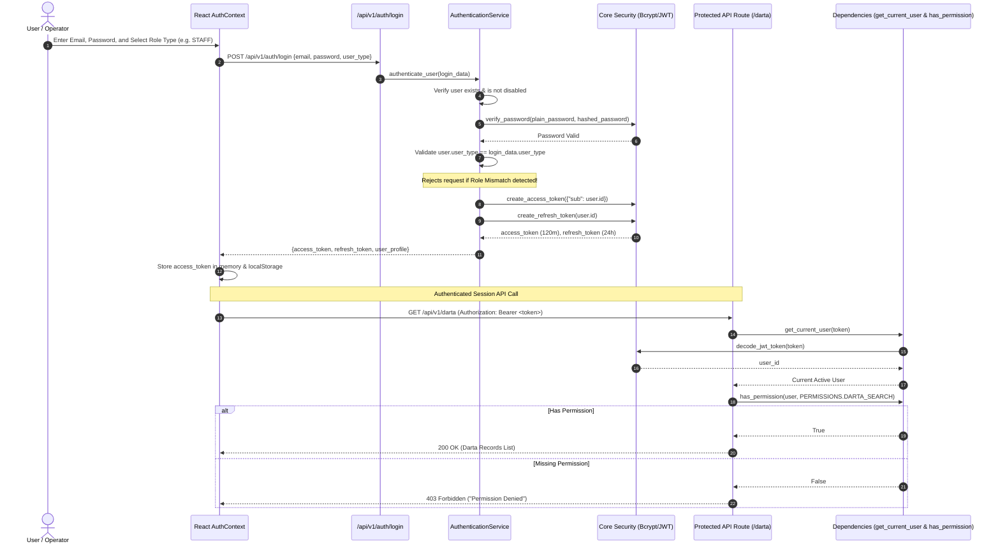
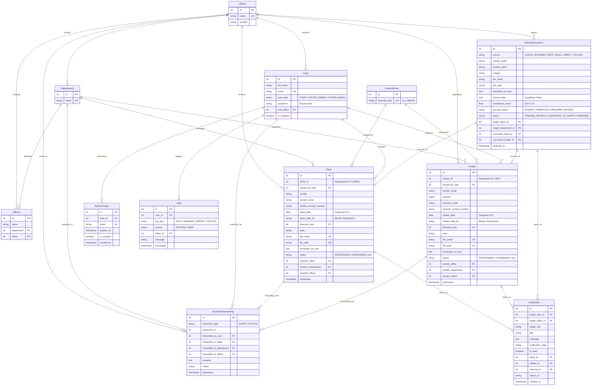
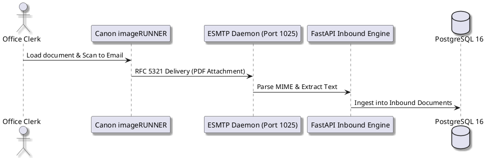

# Nepal Telecom Corporation (NTC) — Darta-Chalan Digitization System
# Flow Architecture & UML Diagram Specification

> **Purpose:** This document specifies the comprehensive flow architecture, data pipelines, sequence diagrams, state machines, and entity-relationship models for the Nepal Telecom Darta-Chalan Digitization Platform.
> **Compatibility:** Formatted in standard **Mermaid** and **PlantUML** code blocks, ready for instant rendering in Claude, ChatGPT, draw.io, PlantText, GitHub, or Mermaid Live Editor.

---

## Table of Contents
1. [High-Level System Architecture (C4 Container Diagram)](#1-high-level-system-architecture-c4-container-diagram)
2. [Sequence Diagram: Inbound SMTP Hardware Scanner Pipeline](#2-sequence-diagram-inbound-smtp-hardware-scanner-pipeline)
3. [Sequence Diagram: USB Desktop Scanner & Windows Bridge Pipeline](#3-sequence-diagram-usb-desktop-scanner--windows-bridge-pipeline)
4. [Sequence Diagram: Sequential Darta Numbering & Registration Flow](#4-sequence-diagram-sequential-darta-numbering--registration-flow)
5. [Sequence Diagram: Chalan Outgoing Dispatch Flow](#5-sequence-diagram-chalan-outgoing-dispatch-flow)
6. [State Machine Diagram: Document Lifecycle & Forwarding](#6-state-machine-diagram-document-lifecycle--forwarding)
7. [Sequence Diagram: Authentication & RBAC Permission Enforcement](#7-sequence-diagram-authentication--rbac-permission-enforcement)
8. [Entity Relationship Diagram (ERD) / UML Database Schema](#8-entity-relationship-diagram-erd--uml-database-schema)
9. [Instructions for Rendering with Claude / Diagram Tools](#9-instructions-for-rendering-with-claude--diagram-tools)

---

## 1. High-Level System Architecture (C4 Container Diagram)

---

## 2. Sequence Diagram: Inbound SMTP Hardware Scanner Pipeline

This sequence illustrates the end-to-end zero-click document intake from physical Canon network printers into the system:

---

## 3. Sequence Diagram: USB Desktop Scanner & Windows Bridge Pipeline

---

## 4. Sequence Diagram: Sequential Darta Numbering & Registration Flow

This diagram illustrates how sequential Darta numbers are strictly generated without race conditions, isolated per branch office and financial year:

---

## 5. Sequence Diagram: Chalan Outgoing Dispatch Flow

---

## 6. State Machine Diagram: Document Lifecycle & Forwarding

---

## 7. Sequence Diagram: Authentication & RBAC Permission Enforcement

---

## 8. Entity Relationship Diagram (ERD) / UML Database Schema

---

## 9. Instructions for Rendering with Claude / Diagram Tools

### How to use this document with Claude:
You can paste any diagram block directly into Claude with prompts such as:
1. *"Render this Mermaid sequence diagram into a visual graphic or SVG."*
2. *"Convert this Mermaid ERD into a formal PlantUML class diagram for academic submission."*
3. *"Generate an interactive draw.io XML structure representing this architecture diagram."*

### How to use with PlantText or PlantUML CLI:
To convert any sequence diagram to PlantUML syntax, use the following template:

---
*Architecture Specification Version: 1.0.0 | Nepal Telecom Corporation IT Division*
